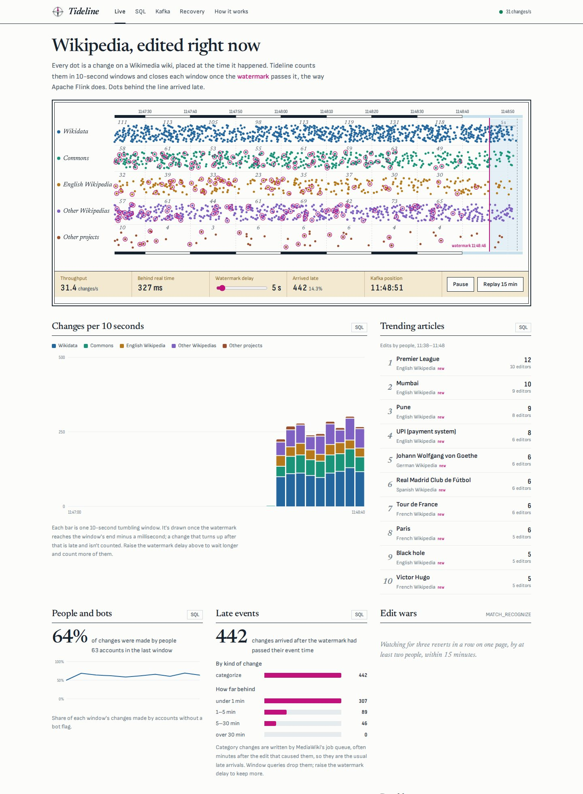
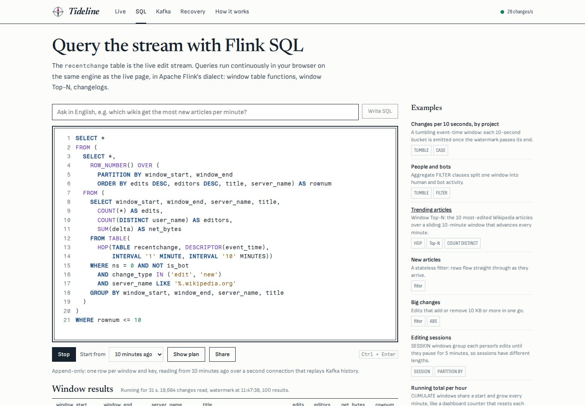
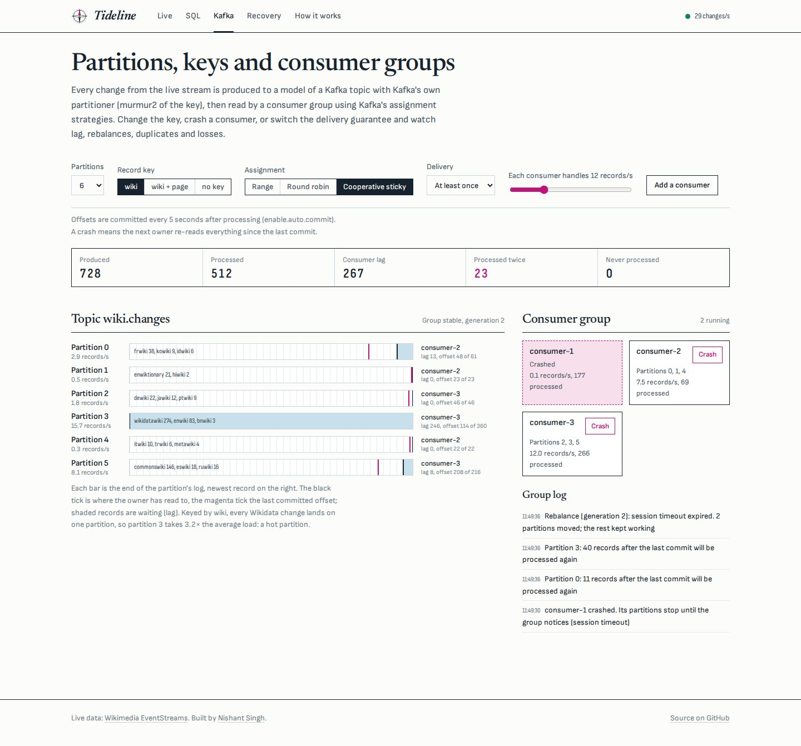
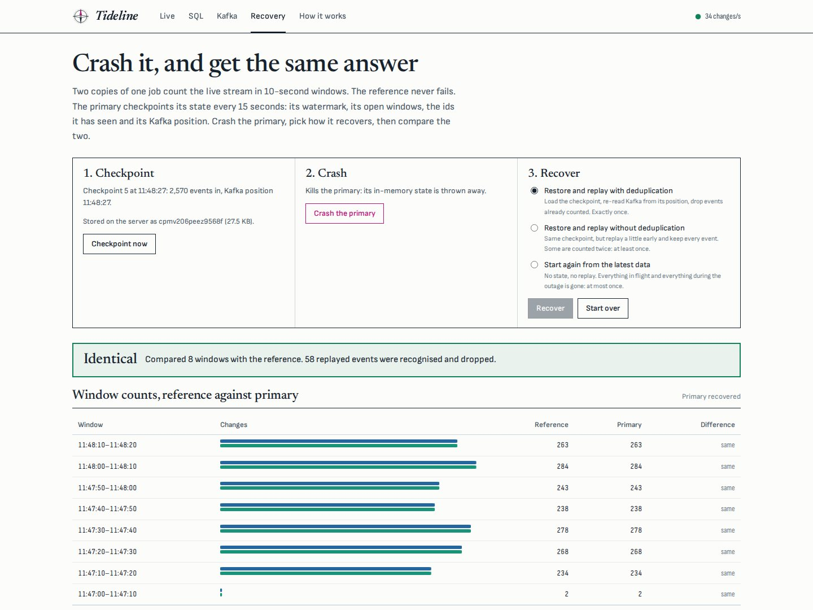
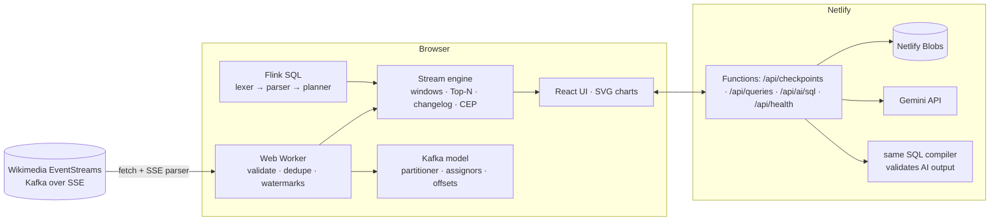
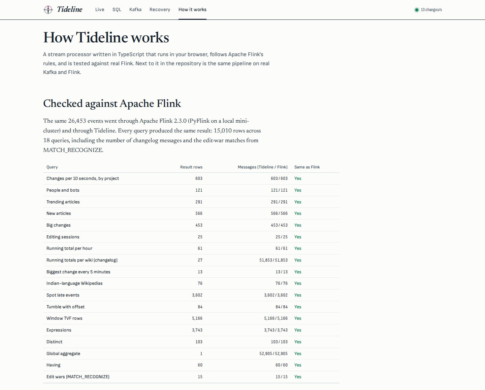

# Tideline

**Stream processing on Wikipedia's live edit stream.** Tideline reads every change made on every Wikimedia wiki, as it happens, and runs Apache Flink-style queries over it in your browser: event-time windows, watermarks, late data, window Top-N, changelogs and pattern matching. It includes a Flink SQL console (or ask in English), a working model of Kafka partitions and consumer groups, and a crash-and-recover demo that shows exactly-once processing. The engine is checked row by row against real Apache Flink.

**Live:** https://tideline-nishant.netlify.app &nbsp;·&nbsp; **Author:** [Nishant Singh](https://nishant-singhaa0240274.netlify.app)



## Features

- **Live.** About 30 changes a second from [Wikimedia EventStreams](https://stream.wikimedia.org/?doc), drawn at the time they happened, with the watermark sweeping across. Dots left behind the line arrived late. Drag the watermark delay and watch the late count change.
  - Live panels: changes per 10-second window by project, trending articles (a window Top-N over a sliding 10-minute window), people and bots, late events by kind and lateness, new articles, big edits, edit wars and dead letters.
  - A diagram of the running job graph with each operator's counters and state size.
- **Flink SQL.** Write queries against the `recentchange` table and they run continuously on the live stream, starting now or replaying from 10 minutes or 1 hour ago.
  - Supported: `TUMBLE`, `HOP`, `CUMULATE` and `SESSION` window table functions, window Top-N, unbounded `GROUP BY` with a retract changelog (`+I`, `-U`, `+U`), `FILTER`, `CASE`, `DISTINCT`, the aggregates and 41 scalar functions.
  - **Show plan** prints a Flink-style `EXPLAIN`. Errors point at the line and column, and read like Flink's.
  - **Ask in English:** Gemini writes the query, and Tideline's own parser compiles it before you see it. If it doesn't compile, the error goes back to the model.
  - **Share** saves a query to a short link.
- **Kafka.** A model of a Kafka topic and consumer group, fed by the live stream.
  - Producing uses Kafka's real partitioner: murmur2 for keyed records, sticky batches without a key.
  - Change the key and see a hot partition (every Wikidata change lands on one).
  - Switch between range, round-robin and cooperative-sticky assignment.
  - Crash a consumer and watch the rebalance and the lag.
  - Under at-most-once, at-least-once or exactly-once delivery, it counts what gets lost or processed twice.
- **Recovery.** Two copies of one job count the stream. The primary checkpoints its state to the server every 15 seconds: Kafka position, watermark, open windows and recently seen ids.
  - Crash it, then recover in one of three ways: restore and replay with deduplication (exactly once), without deduplication (at least once), or from the latest data (at most once).
  - A window-by-window comparison with the reference shows the difference.
- **How it works.** The parity report against Apache Flink, the architecture, and which course each part puts into practice.







## Checked against Apache Flink

The same 26,453 events went through Apache Flink 2.3.0 (PyFlink, local mini-cluster) and through Tideline's engine. **All 18 queries give the same result: 15,010 rows**, including the count of changelog messages and the `MATCH_RECOGNIZE` edit-war matches.

- The settings make Flink's output repeatable: parallelism 1, UTC, and a watermark after every record (`pipeline.auto-watermark-interval = 0`).
- The test data comes from a deterministic generator modelled on the real stream, because the live stream can't be replayed in CI. It includes late category changes and edit wars.
- The check caught two real bugs in Tideline, both now fixed. A window table function used without aggregation was dropping late rows instead of passing them through. The edit-war matcher was forgetting a revert that could still start a match.
- On **Flink 1.20.3**, 17 of the 18 queries give the same result. The exception is a tumbling window with an offset (`TUMBLE(..., INTERVAL '1' MINUTE, INTERVAL '15' SECOND)`): Flink 1.20.3 itself emits only every other window, with lower counts. Flink 2.3.0 and Tideline emit every window, with the same numbers.

```bash
npm test                                      # 167 checks, including parity with the committed Flink results
pip install apache-flink==2.3.0               # needs Java 11+
npm run parity:data && python3 tests/flink/run_flink.py && npm test -- parity   # re-run Flink yourself
```

## The same pipeline on real Kafka and Flink

`pipeline/` runs it for real with Docker Compose. A Python producer reads EventStreams, validates and flattens each event, and produces it to Kafka. The producer is:

- idempotent;
- keyed by wiki with Java-compatible murmur2 partitioning;
- writing Avro, with the schema in Schema Registry;
- backed by a dead-letter topic for events that fail validation.

One Flink SQL job runs the website's queries, generated from the same source file (`shared/queries.ts`). It keeps RocksDB state, checkpoints every 10 s, and writes results back to Kafka exactly once. See [pipeline/README.md](pipeline/README.md).

## Architecture



- **`shared/engine/`**: event time and watermarks (bounded out-of-orderness), window assigners, window and group aggregates (with retractions), window Top-N, the edit-war detector (`MATCH_RECOGNIZE` semantics), and snapshot/restore for every operator.
- **`shared/sql/`**: a lexer, a recursive-descent parser for Flink's dialect (431 reserved words), and a planner.
  - The planner type-checks with Flink's rules: integer division, `AVG` of an `INT` is an `INT`, three-valued logic, case-sensitive names.
  - It produces operators (`Calc`, `WindowAggregate`, `GroupAggregate`, `WindowRank`, `Limit`) and an `EXPLAIN` plan.
- **`shared/kafka/`**: Kafka's murmur2 partitioner (checked against the Java client's outputs), plus range, round-robin and cooperative-sticky assignors.
- **`src/worker/`**: the stream client. It reads Wikimedia's SSE wire format with `fetch`, reconnects with `?since=`, and deduplicates by `meta.id`. Every event carries its Kafka topic, partition and offset.

### API

| Method | Path | What it does |
|---|---|---|
| POST | `/api/checkpoints` | Store a recovery checkpoint (state snapshot), get an id |
| GET | `/api/checkpoints/:id` | Load it back |
| POST | `/api/queries` | Save a SQL query, get a share id |
| GET | `/api/queries/:id` | A shared query |
| POST | `/api/ai/sql` | Question in English → Flink SQL that compiles, with an explanation |
| GET | `/api/health` | Status and whether AI is configured |

Everything is validated with Zod and rate-limited per visitor. The AI endpoint also has a daily cap to protect the API quota. A daily scheduled function deletes checkpoints older than a day and old rate-limit counters. Shared queries are kept.

## Tech stack

TypeScript everywhere · React 18 + Vite · Web Workers · Netlify Functions (Node 22) · Netlify Blobs · Zod · Gemini API (structured JSON output) · hand-built SVG charts · Python (confluent-kafka, Avro, pytest, PyFlink) · Docker Compose · Apache Kafka (KRaft) · Confluent Schema Registry · Apache Flink · GitHub Actions.

Design: a nautical chart. The page is chart paper with shoal-blue water still "open" for late data, buff land for the control panel, and a magenta tide line for the watermark. Type is Newsreader, Sofia Sans and Fragment Mono.



## Run it yourself

```bash
npm install
npx netlify dev                       # http://localhost:8888, reading the real stream
```

Offline, with a local stand-in for EventStreams (same wire format, `?since=` replay and dropped connections):

```bash
npm run mock                          # http://localhost:8787
VITE_STREAM_URL=http://localhost:8787/v2/stream/recentchange npx netlify dev
```

**Deploy on Netlify:** build command `npm run build`, publish directory `dist`.

| Environment variable | Required | What it does |
|---|---|---|
| `GEMINI_API_KEY` | No | Enables "Ask in English". Without it, everything else works. |
| `GEMINI_MODEL` | No | Overrides the model choice |
| `DAILY_AI_LIMIT` | No | AI requests per day across all visitors (default 300) |

## Tests

| Command | What it checks |
|---|---|
| `npm test` | 167 checks: window firing at `watermark >= window_end - 1`, every window type, changelogs, Top-N, time zones, checkpoint → crash → restore giving exactly-once results, edit-war matching, SQL parsing, typing and errors, three-valued logic, murmur2 against Kafka's Java client, the assignors, and the parity with Flink |
| `python3 tests/api_test.py` | 20 end-to-end API checks against `netlify dev` with a mock Gemini (`tests/mock_gemini.py`): checkpoints, shared queries, AI retries with the parser's error, unanswerable questions, rate limits |
| `cd pipeline/producer && pytest` | The Kafka producer, on librdkafka's mock cluster and a mock Schema Registry |
| `python3 pipeline/flink/check_sql.py` | The pipeline's Flink job, planned and run by Flink itself |
| `npm run typecheck` | Strict TypeScript |

CI runs all of them on every push (`.github/workflows/ci.yml`), with Flink 1.20.3 and 2.3.0.

## Limits

- The browser engine runs with parallelism 1 and keeps state in memory. It's for learning and demonstrating the semantics, not a replacement for Flink.
- Wikimedia's stream resumes from a timestamp, not an exact offset, so recovery replays a little overlap and relies on deduplication by event id.
- The Docker Compose stack wasn't started in the environment this was built in (no container runtime). Its SQL is validated by Flink's planner and its producer by tests.

## License

Code: MIT © 2026 Nishant Singh. Live data: [Wikimedia EventStreams](https://wikitech.wikimedia.org/wiki/Event_Platform/EventStreams_HTTP_Service). Wikimedia content is available under [CC BY-SA 4.0](https://creativecommons.org/licenses/by-sa/4.0/).
